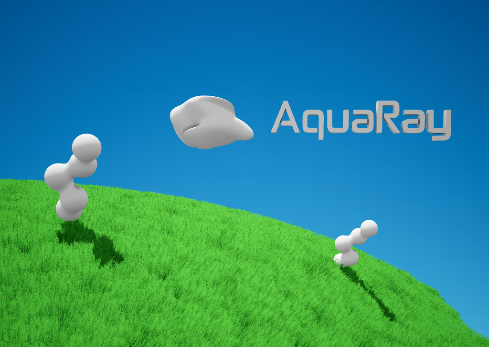
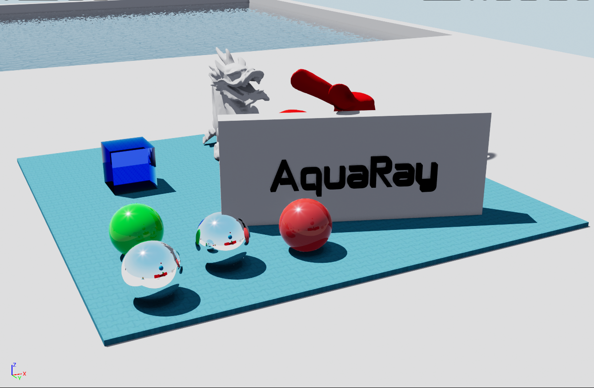
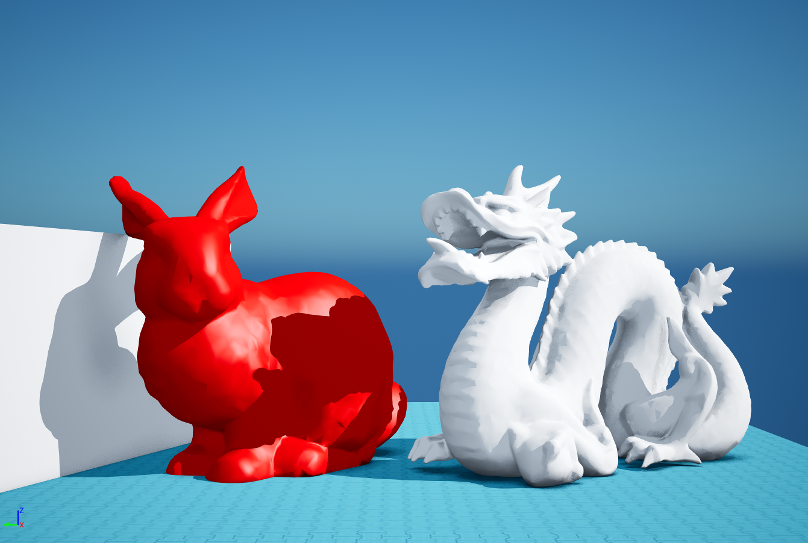
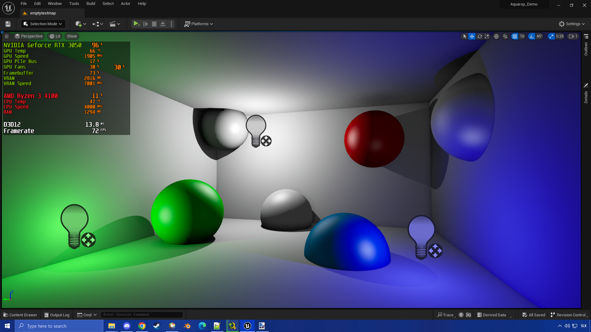

# __AquaRay - Custom Raytracing Shader pipeline for Unreal Engine 5.2.1__
A Custom set of shaders for Custom Realtime Raytracing. 

# Current state of the Project
- I am currently working on the full scale version of the project.
- ~~When the next phase reaches a working state, a new repository will be created.~~ There is an outbreak of people using AI to clone creative projects and claim them as "their" products. I dont want the AquaRay Project to end up in somebody´s AI generated game engine, so I decided the full scale version of AquaRay will be Closed Source. Im sorry :(
- Therefore this repository will be abandoned/left here for public viewing.

## Update 13.1
- (C++) Fixed Console Command Spam 
- (C++) Fixed StaticFindObjectFast() crashes (I hope) 
- Reduced Shadow Artifact Issues 

Check changelog.txt for previous versions 

## Current Features
- Whitted Style Raytracing 
- Direct Lighting With Point Light Support 
- Simple One-Raypath Shadows 
- Reflections & Translucency up to 10 steps 
- Reflected Direct Lighting 
- Simple Fog 
- Water 

__Performance Target:__ 60fps at 1440x1080 Resolution on Nvidia RTX 3050 (at Native Resolution/Framerate with No Temporal Accumulation, Upscaling or FrameGen) 
__Current Performance Result:__ 75-80fps in Medium Complexity scenes. Shaders are currently compiled without optimization so the Final result may run faster. Framerate Heavily depends on whats on the screen 

__GPU Requirements: __
- DirectX 12 Support 
- Hardware Raytracing Support 

QA: 
__Why is this not a Plugin?:__ Overriding Vannila Unreal Rendering is Impossible using a Plugin. Any Renderer of this scale must be done via Modifying Unreal Source 
__Can you Update the Renderer to a Higher Unreal Version?:__ No guarantees, but I think this code can be ported easily with (maybe) minimal changes up to (as of writing) 5.8.0. 

## __How to Install__
Follow the wiki for Installation: 
[Install: Unreal Engine Source](https://github.com/Dechetmew/Aquaray-Raytracing-Renderer-for-Unreal-5.2.1/wiki/1:-Install:-Unreal-Engine-Source) 
[Install: Fixing Existing Engine Issues](https://github.com/Dechetmew/Aquaray-Raytracing-Renderer-for-Unreal-5.2.1/wiki/2:-Install:-Fixing-Existing-Engine-Issues) 
[Install: Installing AquaRay](https://github.com/Dechetmew/Aquaray-Raytracing-Renderer-for-Unreal-5.2.1/wiki/4:-Install:-Installing-Old-Versions) 

## __Credits__
The Sample project uses: 
-Skyboxes from [PolyHaven](https://polyhaven.com/) 
-Some Models by the [Stanford University](https://graphics.stanford.edu/data/3Dscanrep/) 

## Gallery

